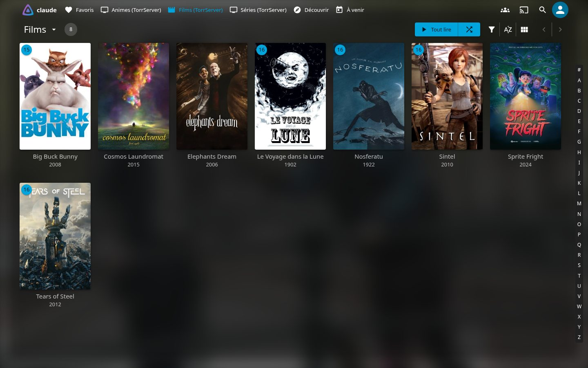
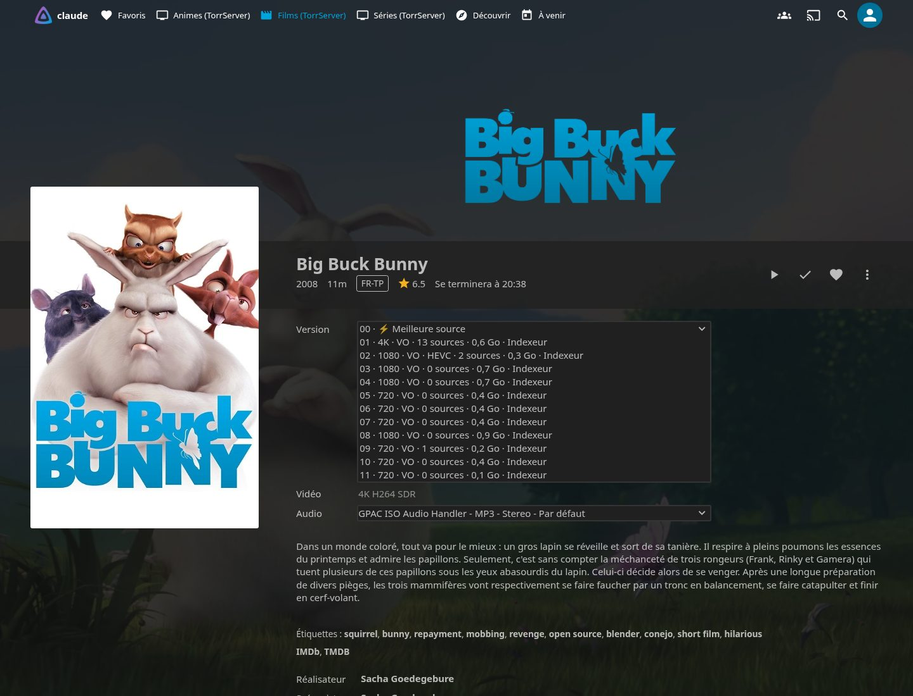
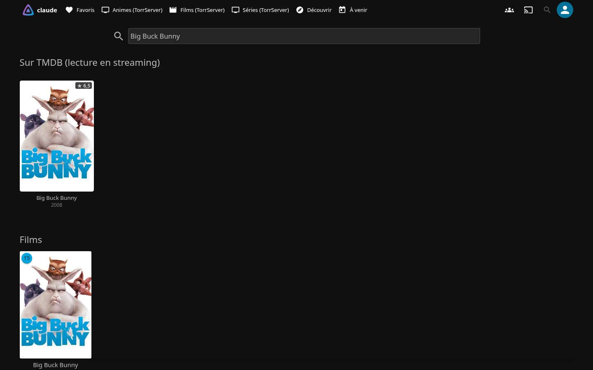
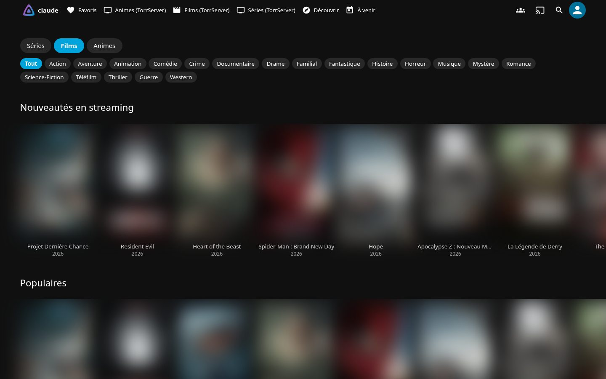
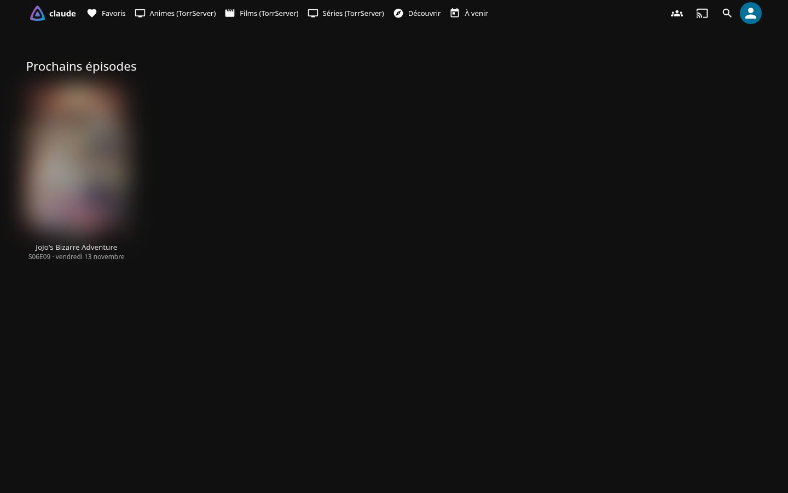
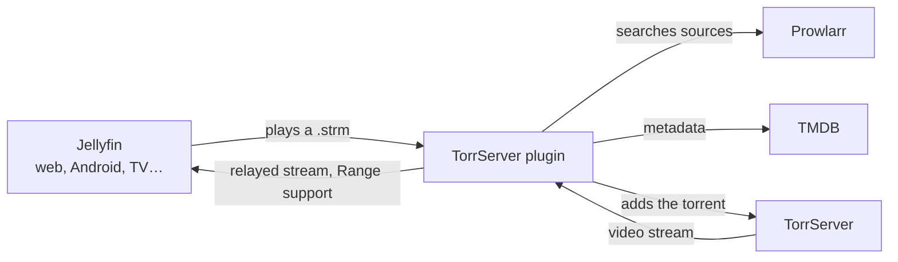

<div align="center">


# Jellyfin TorrServer

**Stream movies, TV shows and anime from torrents right inside Jellyfin, without downloading anything to disk.**

Everything happens in Jellyfin's native interface: real library items, "Continue watching", "Played", and every client (web, Android, Android TV, iOS, Kodi…).

[](https://github.com/jonathan-pp/jellyfin-torrserver/actions/workflows/build.yml)
[](https://github.com/jonathan-pp/jellyfin-torrserver/releases)
[](https://jellyfin.org)
[](https://dotnet.microsoft.com)
[](LICENSE)

[🇫🇷 Français](README.md) · 🇬🇧 English



</div>

> The plugin's interface is in French. Source selection works for any language: set your preferred release tags (e.g. `multi`, `vostfr`, `english`) in the **Sources** tab.

## Features

**Catalog and discovery**
- A **Discover page** added to Jellyfin's menu: TV, Movies and Anime tabs with Trending, Popular, On the air, Top rated and New on streaming rows.
- **Genre filters** and an **"In production"** category (shows still airing), with infinite scrolling.
- **TMDB search** inside Jellyfin's search, plus actor pages and recommendations.
- Clicking a poster creates the item and opens **its real Jellyfin page**.

**Playback**
- **Sources from Prowlarr**, searched by TMDB id and by title across all your indexers.
- **Automatic best-source pick**: preferred language, resolution, seeders, sensible size, H.264 preferred, CAM/TS rejected.
- Jellyfin's native **Version menu** lists every source; `00 · ⚡ Meilleure source` picks automatically.
- **Dead sources are skipped** after 45 s without data, the **next episode is prepared** in advance, season packs and absolute anime numbering are handled.
- **Subtitles** are extracted ahead of time.

**Anime**
- A separate **Anime library**, with seasons rebuilt when TMDB puts everything in one huge season (Re:ZERO…).
- **Skip intro / skip credits** from [AniSkip](https://aniskip.com), with TMDB → MyAnimeList mapping from [Fribb/anime-lists](https://github.com/Fribb/anime-lists).

**Upcoming episodes**
- **Next episode** date at the top of each followed show's overview, with the exact time for anime (AniList).
- An **"À venir" (Upcoming) page**, an **on-screen notice** on release day, and a per-user **`.ics` calendar** feed.

**Multiple users**
- **Private libraries**: each account only sees the titles it opened (lists, search, "Continue watching").
- **Monthly quota** in GB per user with an 80 % warning, per-user **indexer access** and **source profile**, and **usage statistics**.

**Maintenance**
- **Automatic cleanup** of titles not opened for 30 days, an optional **automatic catalog**, and an optional **VPN status** display.

## Screenshots

| | |
|---|---|
|  |  |
|  |  |

<sub>Taken with a demo account and free-licensed films (Blender films under Creative Commons, public-domain films). Posters of copyrighted works are blurred and indexer names hidden.</sub>

## How it works



The library only holds tiny `.strm` files. On playback the plugin finds the best source in Prowlarr, sends it to TorrServer, picks the right file (even inside a season pack) and relays the stream to Jellyfin.

## Requirements

- [Jellyfin](https://jellyfin.org) **12.4** (.NET 10)
- [TorrServer](https://github.com/YouROK/TorrServer)
- [Prowlarr](https://prowlarr.com) with your indexers
- A [TMDB](https://www.themoviedb.org/settings/api) read access token
- The **File Transformation** plugin (repository: `https://www.iamparadox.dev/jellyfin/plugins/manifest.json`), which adds the Discover and Upcoming pages to the web UI

## Installation

1. In Jellyfin: **Dashboard → Plugins → Repositories → +**, and add:
   ```
   https://raw.githubusercontent.com/jonathan-pp/jellyfin-torrserver/main/manifest.json
   ```
2. In the **Catalog**, install **TorrServer** (and **File Transformation**).
3. Restart Jellyfin.
4. Open **Plugins → TorrServer**:
   - **Connexions** tab: fill in TMDB, Prowlarr and TorrServer, then click **Tester les connexions** (test connections).
   - **Bibliothèque** tab: click **Créer les bibliothèques** (create the libraries).
5. Reload Jellyfin: **Découvrir** (Discover) and **À venir** (Upcoming) appear in the menu.

## Build

```sh
dotnet build src -c Release   # .NET 10, Jellyfin 12.4
python3 package.py            # dist/TorrServer-<version>.zip and manifest.json
```

See [CONTRIBUTING.md](CONTRIBUTING.md) and the [changelog](CHANGELOG.md).

## Disclaimer

This plugin is a technical bridge between Jellyfin and existing software (TorrServer, Prowlarr). It does not provide, host or index any content and is not affiliated with any indexer. Only use it with content you have the right to stream: public-domain works, freely licensed works (Creative Commons…) or works you own the rights to. You are solely responsible for the sources you configure and for complying with copyright law in your country.

## License

[MIT](LICENSE)

<sub>Keywords: Jellyfin torrent plugin, Jellyfin torrent streaming, TorrServer, Prowlarr, TMDB, AniSkip, skip intro, anime, .strm library, self-hosted, homelab.</sub>
