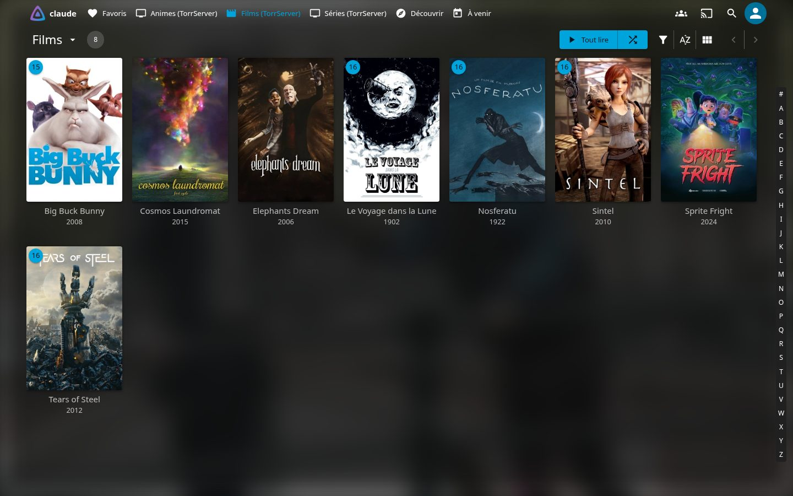
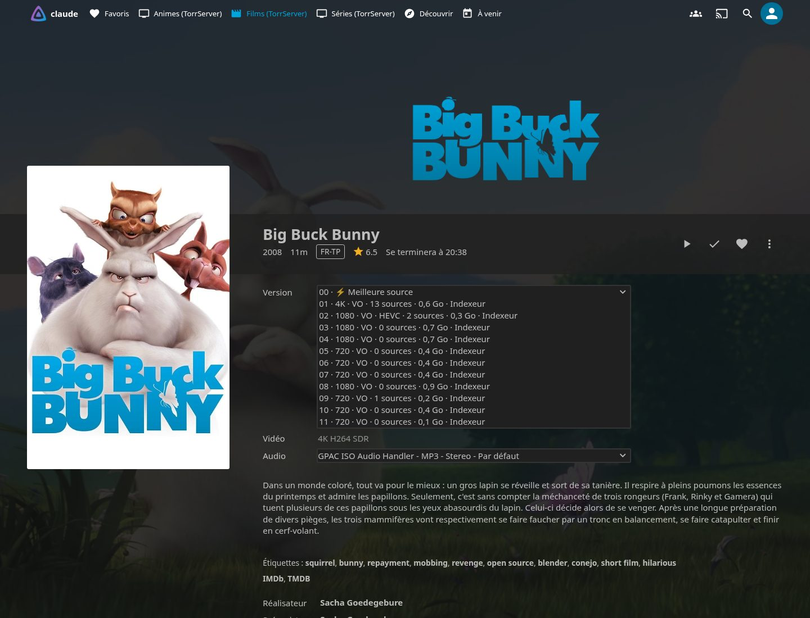
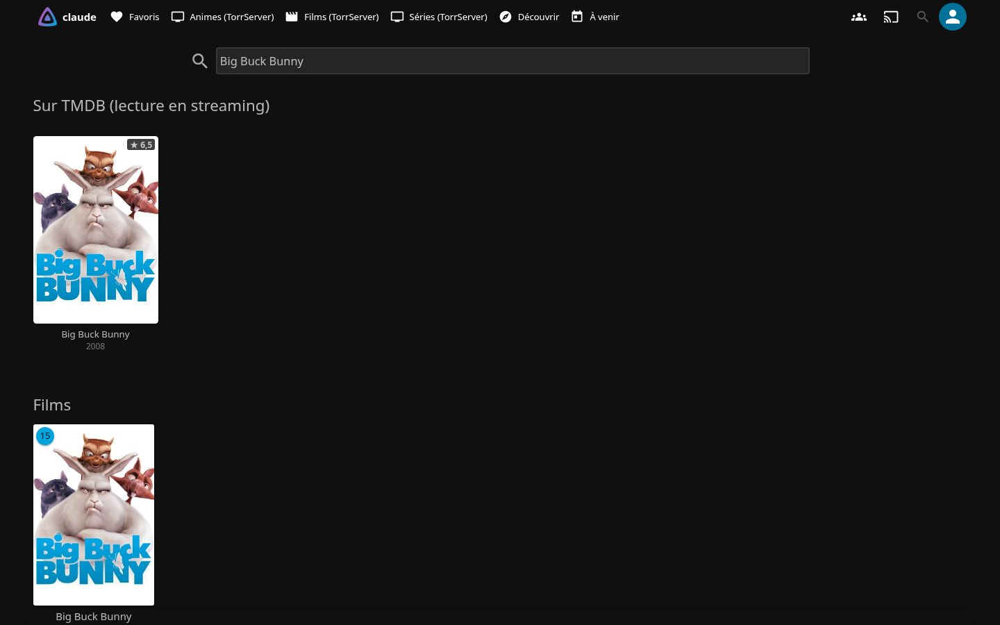
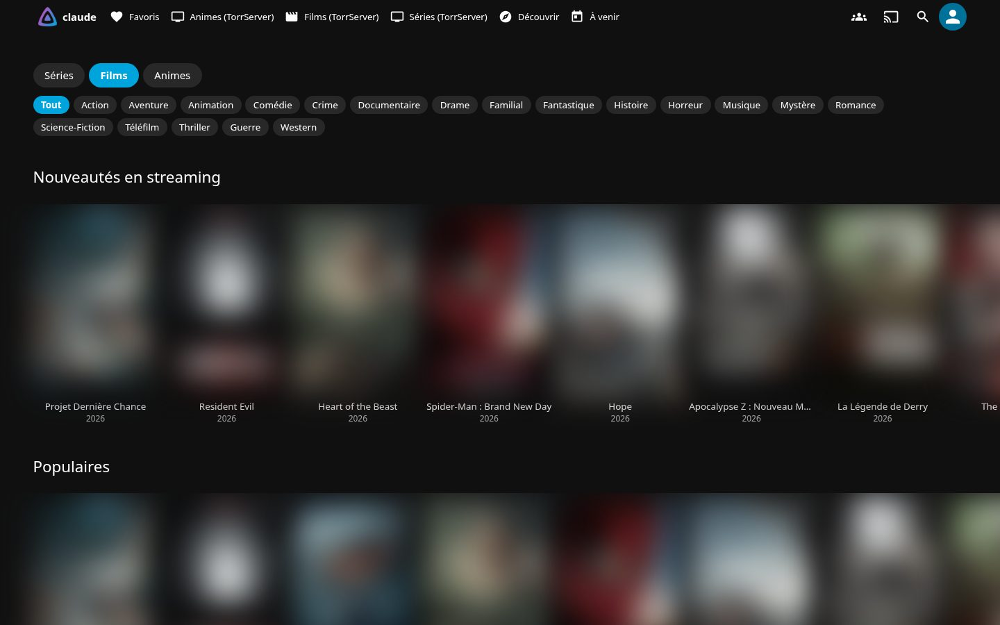
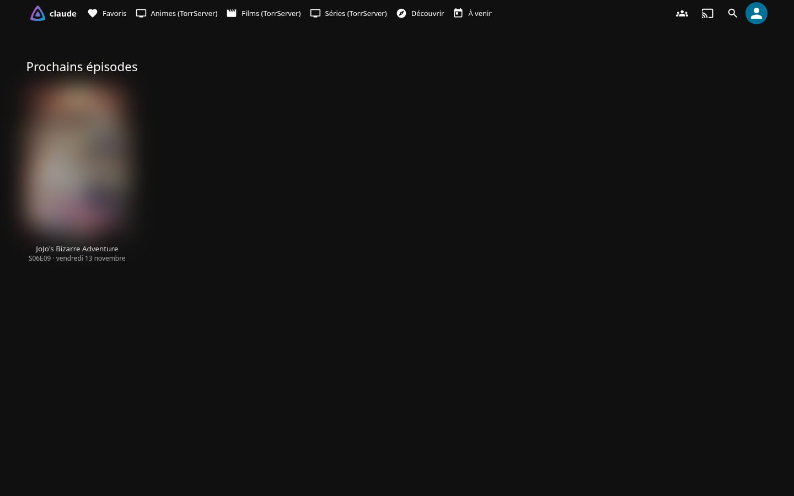
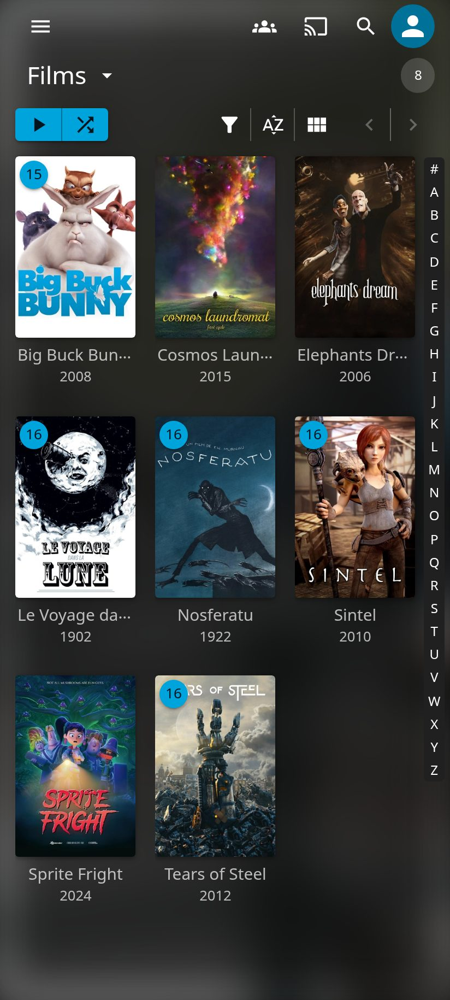
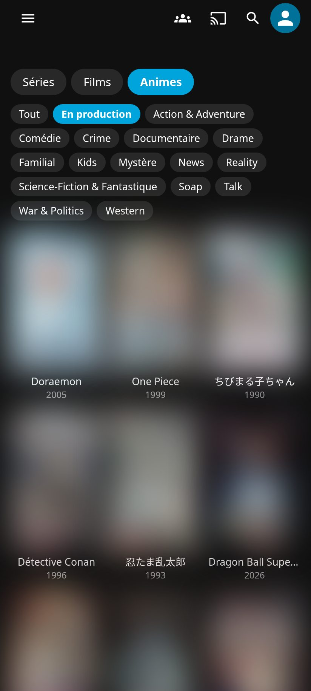
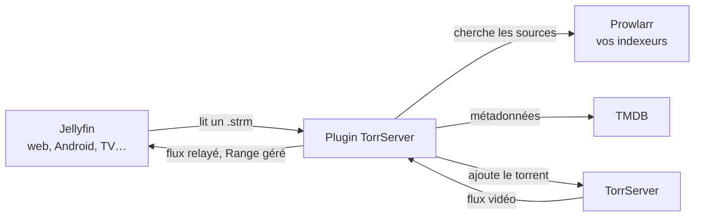

<div align="center">


# Jellyfin TorrServer

**Films, séries et animes en streaming par torrent, directement dans Jellyfin, sans rien télécharger sur le disque.**

Tout se passe dans l'interface native de Jellyfin : vraies fiches, « Reprendre », « Vu », tous les clients (web, Android, Android TV, iOS, Kodi…).

[](https://github.com/jonathan-pp/jellyfin-torrserver/actions/workflows/build.yml)
[](https://github.com/jonathan-pp/jellyfin-torrserver/releases)
[](https://jellyfin.org)
[](https://dotnet.microsoft.com)
[](LICENSE)

🇫🇷 Français · [🇬🇧 English](README.en.md)



</div>

---

## Sommaire

- [Fonctionnalités](#fonctionnalités)
- [Captures d'écran](#captures-décran)
- [Comment ça marche](#comment-ça-marche)
- [Prérequis](#prérequis)
- [Installation](#installation)
- [Configuration](#configuration)
- [Utilisation](#utilisation)
- [Questions fréquentes](#questions-fréquentes)
- [Détails techniques](#détails-techniques)
- [Compiler et contribuer](#compiler-et-contribuer)
- [Avertissement](#avertissement)

## Fonctionnalités

### Catalogue et découverte
- **Page « Découvrir »** ajoutée au menu de Jellyfin : onglets Séries, Films et Animes, rangées Tendances, Populaires, À l'antenne, Les mieux notés, Nouveautés en streaming.
- **Filtres par genre** (Action, Comédie, Drame, Science-fiction…) et catégorie **« En production »** (séries encore diffusées), avec défilement infini.
- **Recherche TMDB** intégrée à la recherche de Jellyfin : une ligne « Sur TMDB » s'ajoute aux résultats.
- **Fiches acteur et recommandations** : filmographie et titres similaires, ouverts en un clic.
- Un clic sur une affiche crée le titre et ouvre **sa vraie fiche Jellyfin**, avec un pourcentage de chargement.

### Lecture
- **Recherche des sources dans Prowlarr** : par identifiant TMDB et par titre (français, original, anglais), sur tous vos indexeurs.
- **Choix automatique de la meilleure source** : langue préférée (MULTI, VFF, VOSTFR…), résolution, nombre de sources, taille raisonnable, H.264 de préférence, CAM/TS écartés.
- **Menu « Version »** natif de Jellyfin : `00 · ⚡ Meilleure source`, puis chaque source avec sa qualité, sa langue, son nombre de sources, sa taille et son indexeur.
- **Sources affichées au fur et à mesure** : les premières apparaissent en quelques secondes.
- **Source morte remplacée sans erreur** : si un torrent n'envoie rien en 45 s, le plugin passe au suivant.
- **Épisode suivant préparé à l'avance**, packs de saison reconnus, numérotation absolue des animes gérée.
- **Sous-titres** du fichier extraits à l'avance pour s'afficher sans attente.

### Animes
- **Bibliothèque « Animes » séparée** (animation japonaise).
- **Saisons redécoupées** quand TMDB range tout dans une seule saison géante (Re:ZERO…), grâce au groupe d'épisodes « Seasons » de TMDB.
- **« Passer l'intro » et « Passer le générique »** grâce à [AniSkip](https://aniskip.com), avec la correspondance TMDB → MyAnimeList de [Fribb/anime-lists](https://github.com/Fribb/anime-lists) et les épisodes d'[AniList](https://anilist.co).

### Prochains épisodes
- **« ⏳ Prochain épisode »** en tête du résumé de chaque série suivie, avec l'heure exacte pour les animes (AniList).
- **Page « À venir »** dans le menu : les prochaines sorties de vos séries, avec « demain », « dans 3 jours »…
- **Avertissement à l'écran** le jour de la sortie, puis préparation automatique de l'épisode suivant.
- **Épisode à venir visible dans la saison** (« pas encore diffusé »), sans recherche de source avant sa sortie.
- **Agenda `.ics`** par utilisateur, à ajouter dans Google Agenda, Apple Calendrier ou Outlook.

### Plusieurs utilisateurs
- **Bibliothèque personnelle** : chacun ne voit que les titres qu'il a ouverts, ni dans les listes, ni dans la recherche, ni dans « Reprendre ».
- **Quota mensuel en Go** par utilisateur, avec un avertissement à 80 % et la lecture refusée au-delà.
- **Droits par utilisateur** : accès à « Découvrir », indexeurs autorisés, profil de sources (langues, résolution maximale, tailles).
- **Statistiques** : Go lus par utilisateur et par mois, titres les plus regardés.

### Entretien
- **Nettoyage automatique** des titres ni ouverts ni lus depuis 30 jours ; l'historique « Vu » revient si le titre est rouvert.
- **Catalogue automatique** facultatif : titres populaires de TMDB ajoutés d'eux-mêmes.
- **État du VPN** facultatif (IP publique et connexion) si TorrServer passe par un VPN comme Gluetun.

## Captures d'écran

<table>
  <tr>
    <td width="50%"><br><sub><b>Menu Version</b> : la meilleure source automatique, ou une autre au choix.</sub></td>
    <td width="50%"><br><sub><b>Recherche</b> : une ligne « Sur TMDB » s'ajoute aux résultats de Jellyfin.</sub></td>
  </tr>
  <tr>
    <td><br><sub><b>Découvrir</b> : Séries, Films, Animes, genres et « En production ».</sub></td>
    <td><br><sub><b>À venir</b> : les prochaines sorties de vos séries.</sub></td>
  </tr>
  <tr>
    <td colspan="2" align="center"> <br><sub><b>Sur téléphone</b>, dans l'application Jellyfin.</sub></td>
  </tr>
</table>

<sub>Captures réalisées avec un compte de démonstration et des films libres de droits (films Blender sous licence Creative Commons, films du domaine public). Les affiches d'œuvres protégées sont floutées et les noms d'indexeurs masqués.</sub>

## Comment ça marche



1. Le plugin crée de **vrais titres dans la bibliothèque** : de simples fichiers `.strm` de quelques octets. Jellyfin récupère lui-même les affiches et les résumés.
2. À la lecture, il **cherche les sources** dans Prowlarr et choisit la meilleure selon vos préférences.
3. Il l'envoie à **TorrServer**, trouve le bon fichier (même un épisode dans un pack de saison) et **relaie le flux** à Jellyfin. Rien n'est écrit sur le disque.

## Prérequis

| Outil | Rôle |
|---|---|
| [Jellyfin](https://jellyfin.org) **12.4** (.NET 10) | Le serveur multimédia |
| [TorrServer](https://github.com/YouROK/TorrServer) | Lit les torrents en streaming |
| [Prowlarr](https://prowlarr.com) | Interroge vos indexeurs |
| Jeton [TMDB](https://www.themoviedb.org/settings/api) (lecture) | Catalogue, affiches, épisodes |
| Plugin **File Transformation** | Ajoute « Découvrir », « À venir » et la recherche TMDB à l'interface web |

Dépôt du plugin File Transformation : `https://www.iamparadox.dev/jellyfin/plugins/manifest.json`

## Installation

1. Dans Jellyfin : **Tableau de bord → Extensions → Dépôts → +**, puis ajouter :
   ```
   https://raw.githubusercontent.com/jonathan-pp/jellyfin-torrserver/main/manifest.json
   ```
2. Dans **Catalogue**, installer **TorrServer** (et **File Transformation** si ce n'est pas déjà fait).
3. Redémarrer Jellyfin.
4. Ouvrir **Extensions → TorrServer** et suivre la [configuration](#configuration).

Installation manuelle : télécharger le zip de la [dernière version](https://github.com/jonathan-pp/jellyfin-torrserver/releases/latest) et le décompresser dans `plugins/TorrServer_<version>/` du dossier de données de Jellyfin.

## Configuration

La page **Extensions → TorrServer** est organisée en onglets :

| Onglet | Contenu |
|---|---|
| **Aperçu** | Catalogue automatique, titres ouverts, recherche des nouveaux épisodes |
| **Connexions** | TMDB, Prowlarr, TorrServer, bouton « Tester les connexions », état du VPN |
| **Bibliothèque** | Catalogue automatique, nettoyage, dossier des bibliothèques, bouton « Créer les bibliothèques » |
| **Sources** | Langues préférées, résolution maximale, H.264, sources minimum, tailles maximales, mots à éviter |
| **Utilisateurs** | Quota mensuel global, puis par compte (liste repliable) : quota, accès à « Découvrir », indexeurs autorisés, profil de sources |
| **Calendrier** | Prochaines sorties de tous les comptes et lien d'agenda `.ics` de chacun |
| **Statistiques** | Go lus par utilisateur et par mois, titres les plus regardés |

Premier démarrage :
1. **Connexions** : renseigner TMDB, Prowlarr (adresse et clé API) et TorrServer, puis cliquer sur **Tester les connexions**.
2. **Bibliothèque** : cliquer sur **Créer les bibliothèques**. « Films (TorrServer) », « Séries (TorrServer) » et « Animes (TorrServer) » sont créées.
3. Recharger Jellyfin : **Découvrir** et **À venir** apparaissent dans le menu.

## Utilisation

- **Ajouter un titre** : ouvrir **Découvrir** (ou chercher le titre), cliquer sur l'affiche. La fiche Jellyfin s'ouvre, prête à lire.
- **Choisir une source** : menu **Version** de la fiche. `00 · ⚡ Meilleure source` laisse le plugin choisir.
- **Suivre une série** : les sorties apparaissent dans **À venir**, en tête du résumé et dans l'agenda `.ics`.
- **Calendrier dans son téléphone** : copier le lien `.ics` de son compte (onglet **Calendrier**) et l'ajouter comme agenda par abonnement.

### État du VPN (facultatif)

Si TorrServer passe par un VPN, un petit script peut écrire toutes les 30 s le fichier `vpn.json` dans le dossier de données du plugin. L'onglet **Connexions** affiche alors l'IP publique et l'état de la connexion :

```json
{ "at": 1767225600, "ip": "203.0.113.42", "online": true, "port": "51820" }
```

`at` est l'heure en secondes Unix ; au-delà de 3 minutes sans mise à jour, l'état est signalé comme ancien.

## Questions fréquentes

<details>
<summary><b>Est-ce que les films sont téléchargés sur le serveur ?</b></summary>

Non. TorrServer garde seulement un petit cache en mémoire ou sur disque, selon sa configuration. La bibliothèque Jellyfin ne contient que des fichiers `.strm` de quelques octets.
</details>

<details>
<summary><b>Pourquoi la lecture met-elle quelques secondes à démarrer ?</b></summary>

Il faut trouver la source, connecter TorrServer aux pairs et analyser le début du fichier. Pour démarrer plus vite, limitez l'analyse de ffmpeg dans l'environnement du service Jellyfin :
`JELLYFIN_FFmpeg__analyzeduration=10M` et `JELLYFIN_FFmpeg__probesize=50M`.
</details>

<details>
<summary><b>Les autres utilisateurs voient-ils mes titres ?</b></summary>

Non. Chaque titre ajouté à la main n'est visible que des comptes qui l'ont ouvert. Le plugin utilise le filtre « Étiquettes bloquées » de Jellyfin. Seuls les titres du catalogue automatique sont communs.
</details>

<details>
<summary><b>« Découvrir » n'apparaît pas dans le menu.</b></summary>

Vérifiez que le plugin **File Transformation** est installé, redémarrez Jellyfin, puis videz le cache du navigateur ou de l'application.
</details>

<details>
<summary><b>Ça marche avec Android TV, Kodi, Infuse… ?</b></summary>

Oui pour la lecture : ce sont de vrais titres Jellyfin. Les pages « Découvrir » et « À venir » sont propres à l'interface web, que l'application Android utilise aussi.
</details>

## Détails techniques

- **Durées** : une version jamais analysée reçoit la durée d'une autre version ou de TMDB ; la version lancée est analysée avant d'arriver au lecteur.
- **Analyses inutiles évitées** : les analyses automatiques de Jellyfin sur chaque `.strm` (un torrent chargé par version) sont refusées, grâce à la détection du processus `ffprobe` via `/proc` (Linux).
- **Versions stables** : une source garde son fichier tant qu'elle reste proposée, ce qui évite à Jellyfin de tout réanalyser.
- **Sécurité** : les adresses de lecture contiennent une clé secrète générée automatiquement. TorrServer n'ayant pas d'authentification, gardez-le sur le réseau local.
- **Transcodage** : au processeur, sauf si l'accélération matérielle est configurée dans Jellyfin.

### Limites
- La liste des versions est commune à tous ; seul le filtrage est propre à chaque utilisateur.
- Les lecteurs externes qui lisent le `.strm` directement utilisent les réglages globaux.

## Compiler et contribuer

```sh
dotnet build src -c Release   # .NET 10, Jellyfin 12.4
./deploy.sh                   # installe dans le Jellyfin local (Linux, systemd)
python3 package.py            # dist/TorrServer-<version>.zip et manifest.json
```

Les contributions sont les bienvenues : voir [CONTRIBUTING.md](CONTRIBUTING.md) et l'[historique des versions](CHANGELOG.md). Pour une faille de sécurité, voir [SECURITY.md](SECURITY.md).

## Avertissement

Ce plugin est un outil technique qui relie Jellyfin à des logiciels existants (TorrServer, Prowlarr). Il ne fournit, n'héberge et n'indexe aucun contenu, et n'est affilié à aucun indexeur. Utilisez-le uniquement avec des contenus que vous avez le droit de diffuser : œuvres du domaine public, sous licence libre (Creative Commons…) ou dont vous détenez les droits. Vous êtes seul responsable des sources que vous configurez et du respect du droit d'auteur dans votre pays.

## Licence

[MIT](LICENSE)

<sub>Mots-clés : plugin Jellyfin torrent, streaming torrent Jellyfin, TorrServer, Prowlarr, TMDB, AniSkip, passer l'intro, animes, bibliothèque .strm, auto-hébergement, homelab.</sub>
